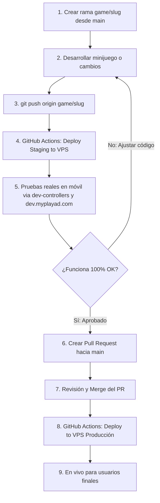

# MyPlayAd - Interactive Digital Signage & Retro Games

Este repositorio contiene el código fuente completo del sistema MyPlayAd, una plataforma de publicidad interactiva y cartelería digital (Digital Signage) que combina reproducción de videos con minijuegos retro (Arkanoid Clon, Cyber Canyon, Duck Hunt, Galaga Clon, Space Invaders Clon, Mega Man Arcade, OutRun Clon, Pacman Clon, Pinball Arcade, Skyroads Clon, Snake Clon) controlados en tiempo real desde los teléfonos de los usuarios.

## Arquitectura del Proyecto

El proyecto está dividido en tres componentes principales:

1. **`portal/` (Next.js):** El panel de administración web y la API pública. Maneja la programación de campañas, gestión de pantallas y proporciona los endpoints que consumen las pantallas.
2. **`screen/` (Node.js + HTML/JS):** El servidor local y frontend que corre físicamente en cada pantalla (ej. Raspberry Pi). Sincroniza y almacena en caché los videos localmente para evitar cortes de internet, y reproduce el bucle publicitario.
3. **`games/` (Static HTML/JS):** Los juegos retro interactivos. Tienen dos vistas: la del juego (que carga la pantalla) y el control (que carga el usuario en su móvil escaneando un código QR).

---

## 📚 Documentación Técnica & Videotutoriales del Portal

Toda la documentación oficial del sistema y sus guías interactivas se encuentran disponibles en la carpeta [`docs/`](docs/):

* 📖 **[Manual del Portal MyPlayAd (Markdown)](docs/MANUAL_PORTAL_MYPLAYAD.md)** / 📄 **[Descargar en Word (.docx)](docs/MANUAL_PORTAL_MYPLAYAD.docx)**: Guía detallada con capturas de pantalla de autenticación, control de energía HDMI-CEC, biblioteca de videos con cuotas, planes de suscripción y gestión de clientes.
* 📖 **[Manual de Producto & Arquitectura (Markdown)](docs/MANUAL_PRODUCTO_MYPLAYAD.md)** / 📄 **[Descargar en Word (.docx)](docs/MANUAL_PRODUCTO_MYPLAYAD.docx)**: Documento integral sobre la arquitectura física, cloud, protocolos WebRTC y ensamblaje de quioscos.
* 🎬 **[Serie de 8 Videotutoriales Interactivos (`docs/videos/`)](docs/videos/)**: Cápsulas audiovisuales HD (1440x900) con cursor interactivo, banners explicativos paso a paso y flujos de negocio completos (alta de planes, tótems, clientes, pauta de videos, programación arcade y bajas).

---

## 📦 3 Opciones de Producto MyPlayAd & Conectividad 4G Plug & Play

MyPlayAd se adapta a cualquier infraestructura mediante **3 opciones de producto** bien diferenciadas:

| Opción de Producto | Entorno Objetivo | Formato & Dimensiones | Requisitos & Conectividad | Características Destacadas |
| :--- | :--- | :--- | :--- | :--- |
| **🕹️ 1. Consola MyPlayAd (Standalone)** | Negocios o empresas de publicidad que **ya tienen pantallas o televisores**. | Dispositivo compacto Plug & Play (Raspberry Pi 5) con salida HDMI y software arcade/publicidad. | Cable HDMI al televisor + corriente + Wi-Fi o red local. | Aprovecha tu inversión previa en pantallas sin comprar nuevo hardware de visualización. Gestión remota Cloud. |
| **🎪 2. Pantalla Mediana Portable** | **Negocios Locales, Stands y Ferias** | Formato estilizado 32" a 43" (Full HD) con atril o soporte portable. | **¡Solo electricidad!** Conexión celular 4G LTE interna preconfigurada. | Ligera, compacta y transportable. Montaje en menos de 5 minutos en mostradores, recepciones o stands. |
| **🏢 3. Pantalla Grande Fija** | **Centros Comerciales (CC / Malls)** | Tótem vertical 43", 55" o 65"+ (Full HD / 4K). | **¡Solo electricidad!** Conexión celular 4G LTE interna preconfigurada. | Estructura fija de alta presencia, visibilidad en pasillos centrales, plazas y plazoletas de comidas. Máximo impacto visual. |

### 📶 Conectividad 4G LTE Incluida (Opciones 2 y 3)
* **100% Autónoma:** Cada pantalla física (Mediana Portable y Grande Fija) incorpora su propio módem celular 4G LTE preconfigurado con tarjeta SIM multi-operador.
* **Sin Trabas de TI:** No necesitas pedir claves de Wi-Fi, tender cables ethernet ni lidiar con firewalls corporativos del centro comercial o local.
* **Plug & Play:** **¡Lo único que necesitas es electricidad!** Conéctala a una toma corriente estándar (110V/220V) y la pantalla arrancará de inmediato, sincronizando sus videos y activando su horario programado.

---
## 🕹️ Catálogo de Minijuegos Disponibles en Producción

<!-- GAMES_CATALOG_START -->
Actualmente la rama principal (`main`) cuenta con **12 minijuegos** interactivos adaptados al estándar **Pure Arcade** (pantalla completa, gabinete centrado, bezel de 440px y QR local offline):

| Juego | Género | Mecánica & Descripción | Controles Móviles / Teclado | Producción | Staging (Dev) |
| :--- | :--- | :--- | :--- | :--- | :--- |
| **🧱 Arkanoid Clon**<br>`arkanoid` | Breakout / Arcade | Clásico rompe-bloques con paleta deflectora, física de rebote balístico y potenciadores. | Deslizador táctil horizontal / Flechas y teclas A-D | 🖥️ [Pantalla](https://myplayad.com/arkanoid/)<br>📱 [Control](https://controllers.myplayad.com/arkanoid/) | 🖥️ [Pantalla](https://dev.myplayad.com/arkanoid/)<br>📱 [Control](https://dev-controllers.myplayad.com/arkanoid/) |
| **🎪 Circus Charlie**<br>`circus` | Arcade / Platformer | El inolvidable clásico de circo: en el Nivel 1 monta al león saltando sobre monitos de circo que corren hacia ti y vasijas de fuego, y en el Nivel 2 salta camas elásticas esquivando tragafuegos bajo el dirigible BONUS. | Joystick virtual analógico (◀ Frenar / Avanzar ▶ / Subir / Bajar) y Botón de Salto ★ / Teclado: Flechas o WASD, Espacio / Teclas 1, 2 y 3 para elegir nivel | 🖥️ [Pantalla](https://myplayad.com/circus/)<br>📱 [Control](https://controllers.myplayad.com/circus/) | 🖥️ [Pantalla](https://dev.myplayad.com/circus/)<br>📱 [Control](https://dev-controllers.myplayad.com/circus/) |
| **🚀 Cyber Canyon**<br>`cybercanyon` | Simulador / Vuelo 3D | Vuelo supersónico en primera persona a través de un cañón cibernético de vectores CRT inspirado en QuestWorld. | Joystick virtual 360° / Flechas de cursor y WASD | 🖥️ [Pantalla](https://myplayad.com/cybercanyon/)<br>📱 [Control](https://controllers.myplayad.com/cybercanyon/) | 🖥️ [Pantalla](https://dev.myplayad.com/cybercanyon/)<br>📱 [Control](https://dev-controllers.myplayad.com/cybercanyon/) |
| **🦆 Duck Hunt**<br>`duckhunt` | Shooter / Arcade NES | El mítico clásico de cacería de patos con la Light Gun Zapper, el perro cazador y rondas progresivas. | Trackpad de mira Zapper + Gatillo / Ratón o Flechas y Espacio | 🖥️ [Pantalla](https://myplayad.com/duckhunt/)<br>📱 [Control](https://controllers.myplayad.com/duckhunt/) | 🖥️ [Pantalla](https://dev.myplayad.com/duckhunt/)<br>📱 [Control](https://dev-controllers.myplayad.com/duckhunt/) |
| **🚀 Galaga Clon**<br>`galaga` | Space Shooter | Shooter espacial clásico contra escuadrones de insectoides alienígenas en formación dinámica. | Deslizador horizontal y botón de disparo táctil / Flechas y Espacio | 🖥️ [Pantalla](https://myplayad.com/galaga/)<br>📱 [Control](https://controllers.myplayad.com/galaga/) | 🖥️ [Pantalla](https://dev.myplayad.com/galaga/)<br>📱 [Control](https://dev-controllers.myplayad.com/galaga/) |
| **👾 Space Invaders Clon**<br>`invaders` | Fixed Shooter | Defensa de la Tierra contra oleadas alienígenas descendentes con búnkeres de protección destructibles. | Botones de dirección y disparo láser táctil / Flechas y Espacio | 🖥️ [Pantalla](https://myplayad.com/invaders/)<br>📱 [Control](https://controllers.myplayad.com/invaders/) | 🖥️ [Pantalla](https://dev.myplayad.com/invaders/)<br>📱 [Control](https://dev-controllers.myplayad.com/invaders/) |
| **🤖 Mega Man Arcade**<br>`megaman` | Action / Run & Gun | El clásico bombardero azul de Capcom en formato arcade: corre, salta, dispara el Mega Buster cargable y derrota a los Robot Masters. | D-Pad direccional / Botones Salto, Mega Buster cargable y Deslizamiento (Slide) | 🖥️ [Pantalla](https://myplayad.com/megaman/)<br>📱 [Control](https://controllers.myplayad.com/megaman/) | 🖥️ [Pantalla](https://dev.myplayad.com/megaman/)<br>📱 [Control](https://dev-controllers.myplayad.com/megaman/) |
| **🏎️ OutRun Clon**<br>`outrun` | Arcade Racing | Carrera retro a alta velocidad con bifurcaciones de ruta hacia 5 metas distintas (A-E) y reloj contrarreloj. | Volante digital, acelerador y freno táctil / Flechas o WASD | 🖥️ [Pantalla](https://myplayad.com/outrun/)<br>📱 [Control](https://controllers.myplayad.com/outrun/) | 🖥️ [Pantalla](https://dev.myplayad.com/outrun/)<br>📱 [Control](https://dev-controllers.myplayad.com/outrun/) |
| **🟡 Pacman Clon**<br>`pacman` | Maze / Arcade | Laberinto retro donde Pacman recolecta puntos y frutas huyendo de los 4 fantasmas. | D-Pad táctil / Teclas de flecha | 🖥️ [Pantalla](https://myplayad.com/pacman/)<br>📱 [Control](https://controllers.myplayad.com/pacman/) | 🖥️ [Pantalla](https://dev.myplayad.com/pacman/)<br>📱 [Control](https://dev-controllers.myplayad.com/pacman/) |
| **⚡ Pinball Arcade**<br>`pinball` | Arcade / Physics Pinball | Mesa arcade de pinball retro con bumpers luminosos, flippers de alta respuesta, rampas y multibola. | Flippers izquierdo/derecho y resorte de lanzamiento / Teclas Z, X y Espacio | 🖥️ [Pantalla](https://myplayad.com/pinball/)<br>📱 [Control](https://controllers.myplayad.com/pinball/) | 🖥️ [Pantalla](https://dev.myplayad.com/pinball/)<br>📱 [Control](https://dev-controllers.myplayad.com/pinball/) |
| **🛸 Skyroads Clon**<br>`skyroads` | Space Platformer / Racing | Nave espacial recorriendo túneles y plataformas en gravedad cero con saltos y turbo. | Joystick analógico virtual + Botones Salto, Turbo y Freno / Teclas de flecha + Espacio | 🖥️ [Pantalla](https://myplayad.com/skyroads/)<br>📱 [Control](https://controllers.myplayad.com/skyroads/) | 🖥️ [Pantalla](https://dev.myplayad.com/skyroads/)<br>📱 [Control](https://dev-controllers.myplayad.com/skyroads/) |
| **🐍 Snake Clon**<br>`snake` | Arcade Retro | La serpiente retro clásica que crece al devorar píldoras, evitando colisiones con bordes y su propio cuerpo. | D-Pad direccional y gestos táctiles de deslizamiento (Swipe) / Flechas del teclado | 🖥️ [Pantalla](https://myplayad.com/snake/)<br>📱 [Control](https://controllers.myplayad.com/snake/) | 🖥️ [Pantalla](https://dev.myplayad.com/snake/)<br>📱 [Control](https://dev-controllers.myplayad.com/snake/) |
<!-- GAMES_CATALOG_END -->


## 🚀 Flujo de Ramas y CI/CD (Staging -> Producción)

El repositorio cuenta con un ciclo de despliegue continuo (CI/CD) automatizado con GitHub Actions sobre el VPS de Hostinger, separando estrictamente el entorno de pruebas (**Staging**) del entorno real (**Producción**).

### 🌐 Entornos y Dominios

| Entorno | Rama Git | Desencadenador CI/CD | Directorio VPS | URLs de Acceso |
| :--- | :--- | :--- | :--- | :--- |
| **Staging** (Pruebas) | `staging`, `feat/**`, `fix/**`, `game/**` | Push a la rama (`deploy-staging.yml`) | `/var/www/myplayad-staging/`<br>`/opt/myplayad-staging/` | 🖥️ Pantallas: `https://dev.myplayad.com/<slug>/`<br>📱 Controles: `https://dev-controllers.myplayad.com/<slug>/`<br>🎛️ Portal: `https://dev-portal.myplayad.com`<br>🎬 Videos: `https://dev-videos.myplayad.com` |
| **Producción** | `main` | Push o Merge a `main` (`deploy.yml`) | `/var/www/myplayad/` (frontend)<br>`/opt/myplayad/` (backend) | 🖥️ Pantallas: `https://myplayad.com`<br>📱 Controles: `https://controllers.myplayad.com/<slug>/`<br>🎛️ Portal: `https://portal.myplayad.com`<br>🎬 Videos: `https://videos.myplayad.com` |

### 🔄 Diagrama del Ciclo de Vida



### 📋 Guía Paso a Paso para Nuevos Juegos (`/game` y `/test`)

> [!TIP]
> Puedes usar el comando **/game** para crear nuevos juegos siguiendo el estándar Pure Arcade, y el comando **/test** para ejecutar el protocolo guiado de pruebas (teclado -> celular en Staging -> merge con bucle interactivo de corrección en el chat).

> [!IMPORTANT]
> **PROHIBIDO desarrollar o commitear juegos directamente en `main`.**
> Commitear en `main` dispara el despliegue directo a los kioscos de producción. Sigue siempre este flujo:

1. **Crear y pasarse a la rama aislada del juego**:
   ```bash
   # Opción recomendada (script automatizado):
   ./.agents/skills/game/scripts/start-game-branch.sh <slug>

   # Opción manual:
   git checkout main && git pull origin main
   git checkout -b game/<slug>
   ```

2. **Desarrollar el Minijuego y Soporte de Teclado**:
   - Implementar la pantalla en `games/<slug>/game/` y el control móvil en `games/<slug>/control/`.
   - Incluir soporte completo de teclado (`ArrowLeft`, `ArrowRight`, `ArrowUp`, `ArrowDown`, `WASD`, `Espacio`, `Enter`) en `game/script.js`.

3. **Probar primero localmente con Teclado (Pre-Push)**:
   - **ANTES** de hacer commit o push, abre `games/<slug>/game/index.html` en tu navegador.
   - Haz clic en la pantalla o pulsa `Espacio`/`Enter` para saltar el QR e iniciar la partida de prueba.
   - Juega 1-2 minutos con el teclado para verificar fluidez a 60fps, detección de colisiones, velocidad de respuesta, puntuación y reinicio.

4. **Subir a Staging para Prueba Móvil**:
   ```bash
   git add games/<slug>/
   git commit -m "feat(game): implementar minijuego <slug>"
   git push origin game/<slug>
   ```
   *El workflow `.github/workflows/deploy-staging.yml` desplegará los cambios en ~20 segundos en `/var/www/myplayad-staging/`.*

5. **Probar en Dispositivos Reales (Staging)**:
   - Abre la pantalla en el navegador: `https://dev.myplayad.com/<slug>/`
   - Escanea el código QR con tu móvil: abrirá `https://dev-controllers.myplayad.com/<slug>/?room=XXXX`
   - Prueba WebRTC, latencia, respuesta táctil, vidas, ranking y reinicio.

6. **Crear Pull Request (PR)**:
   Una vez probado y validado:
   ```bash
   # Opción recomendada:
   ./.agents/skills/game/scripts/promote-to-main.sh <slug>

   # Opción manual:
   gh pr create --base main --head game/<slug> \
       --title "feat(game): agregar minijuego <slug>" \
       --body "Minijuego probado y verificado en Staging."
   ```

7. **Merge y Despliegue en Producción**:
   - Aprueba y mergea el PR (desde la interfaz de GitHub o mediante CLI):
     ```bash
     gh pr merge <PR_URL> --merge --delete-branch
     ```
   - Al mergear en `main`, el workflow `.github/workflows/deploy.yml` actualiza automáticamente el catálogo de juegos en este `README.md` y publica los juegos en producción.
   - Sincroniza tu entorno local:
     ```bash
     git checkout main && git pull origin main
     ```
   - *(Opcional)* Si realizas el merge manualmente en local por CLI:
     ```bash
     python3 .agents/skills/game/scripts/update-games-readme.py
     ```

---

## 🛠️ Cómo Correr el Proyecto Localmente (Desarrollo)

Para probar el proyecto en tu computadora, necesitas tener instalado **Node.js** y **Git**. 

### 1. Iniciar el Portal (Backend/Admin)
El portal provee la API necesaria para que las pantallas sepan qué reproducir.

```bash
cd portal
npm install
npm run dev
```
El portal estará corriendo en `http://localhost:3000`.

### 2. Iniciar el Servidor de Pantalla (Screen Server)
Este es el servidor que corre en la máquina física conectada al televisor (o en tu computador para pruebas). Se encarga de descargar los videos y levantar el reproductor.

Abre una **nueva pestaña** en tu terminal:

```bash
cd screen
npm install

# Inicia el servidor pasando el ID de la pantalla y la URL base de los videos
SCREEN_ID=bc502bba-859c-461c-a795-f6e4bf2d4931 REMOTE_VIDEO_SERVER_URL=https://videos.myplayad.com node server.js
```
*Nota: Reemplaza el `SCREEN_ID` por un ID válido de tu base de datos si estás probando una pantalla específica.*

El servidor local de pantalla estará corriendo en `http://localhost:8090`.

### 3. Probar la Pantalla
Abre tu navegador (Chrome recomendado) e ingresa a:
👉 `http://localhost:8090`

Verás la interfaz de la pantalla principal reproduciendo videos y cambiando a juegos según la programación.

---

## 🎮 Pruebas de Juegos y Controladores

Cuando la pantalla muestre un juego (ej. Snake), aparecerá un **Código QR**. 
1. Escanea el código QR con tu teléfono o copia el enlace.
2. El enlace abrirá la vista del controlador (Joystick/Trackpad) del juego en tu navegador web móvil.
3. Ingresa tu Nickname y la comunicación en tiempo real (vía WebSockets/MQTT) conectará tu teléfono con el juego en la pantalla.

---

## 🍓 Configuración para Raspberry Pi 5 (Producción - Modo Kiosco Wayland)

Para desplegar este sistema en un televisor o pantalla comercial real usando una **Raspberry Pi 5**, el software está diseñado para operar de forma 100% autónoma y desatendida bajo **Debian Bookworm/Trixie de 64 bits** con el compositor gráfico Wayland (`labwc`), aceleración por hardware GPU y sin escritorios tradicionales.

### 1. Instalación Rápida Desatendida (`setup_kiosk.sh`)
1. Flashea la MicroSD con **Raspberry Pi OS (64-bit)** mediante Raspberry Pi Imager.
2. Añade tu `SCREEN_ID` y la rotación al final de `/boot/firmware/config.txt`:
   ```ini
   # Configuración MyPlayAd Screen
   SCREEN_ID="tu-uuid-de-pantalla"
   SCREEN_ROTATE=90
   SCREEN_RESOLUTION=1920x1080
   
   # Forzar señal HDMI activa y CEC para encendido automático de televisor
   hdmi_force_hotplug=1
   hdmi_force_hotplug:0=1
   hdmi_force_hotplug:1=1
   cec_osd_name=MyPlayAd
   ```
3. Conéctate por SSH a la Raspberry Pi y ejecuta el instalador automatizado:
   ```bash
   git clone https://github.com/bmecdev/myplayad.git ~/screen
   cd ~/screen/screen
   chmod +x setup_kiosk.sh
   sudo ./setup_kiosk.sh
   sudo reboot
   ```
El instalador configura automáticamente:
* Dependencias completas (`curl`, `git`, `ffmpeg`, `cec-utils`, `swaybg`, `kanshi`, `chromium`).
* Node.js 20 LTS y paquetes npm del servidor local de pantalla.
* Rotación vertical indestructible por hardware (Kernel DRM/KMS).
* Puntero de ratón invisible a nivel de compositor y CSS.
* Servicio `systemd` y autostart de Wayland para encendido automático de TV por HDMI-CEC.
* Auto-actualización silenciosa al encender (`update.sh`) sincronizada con `origin/main`.

---

## 📺 Configuración del Televisor para Encendido Automático (HDMI-CEC)

El sistema MyPlayAd incluye control total de energía mediante el protocolo estándar **HDMI-CEC** (Consumer Electronics Control). Esto permite que:
1. **Al prender o enchufar la Raspberry Pi 5:** El televisor físico se **encienda automáticamente** desde su estado de reposo (Standby) y **conmute de inmediato a la entrada HDMI** correspondiente sin necesidad de usar el control remoto.
2. **Por Horario Comercial Programado:** La pantalla se apague al cierre del negocio y se encienda a la apertura según las horas definidas en el Portal MyPlayAd.
3. **Control Remoto desde el Portal:** El Super Admin puede apagar o encender las pantallas de forma masiva con un solo clic.

> [!IMPORTANT]
> **Para que el televisor responda a las órdenes de la Raspberry Pi 5, debes activar la función HDMI-CEC en el menú de ajustes del TV.** Los fabricantes utilizan diferentes nombres comerciales para esta tecnología:

### 📋 Guía de Activación por Marca de Televisor:

| Marca | Nombre Comercial CEC | Ruta de Configuración en el Menú del TV | Opciones Obligatorias a Activar |
| :--- | :--- | :--- | :--- |
| **Samsung** | **Anynet+** | *Menú → Configuración → General → Administrador de dispositivos externos → Anynet+ (HDMI-CEC)* | Activar **Anynet+ (HDMI-CEC)**. |
| **LG** | **SIMPLINK** | *Ajustes (Engranaje) → General → Dispositivos → Ajustes de HDMI → SIMPLINK (HDMI-CEC)* | Activar **SIMPLINK (HDMI-CEC)** y activar **Encendido sincronizado de energía**. |
| **Sony** | **BRAVIA Sync** | *Ajustes → Canales y entradas → Entradas externas → Ajustes de BRAVIA Sync* | Activar **Control de BRAVIA Sync** y activar **Encendido automático de TV por dispositivo**. |
| **TCL** | **Control CEC** | *Ajustes → Sistema → Entradas → Control de CEC* | Activar **Control CEC**, activar **Encendido de TV por dispositivo** y **Espera de dispositivo**. |
| **Hisense** | **Control CEC** | *Ajustes → Sistema / Entradas → HDMI y CEC → Control CEC* | Activar **Control CEC**, activar **Auto encendido de TV** y **Auto espera**. |
| **Xiaomi / Smart TV Android / Google TV** | **HDMI-CEC** | *Ajustes → Preferencias del dispositivo / Canales y entradas → Entradas → Control HDMI* | Activar **Control HDMI (CEC)** y activar **Encendido de televisor (TV auto power on)**. |
| **Philips** | **EasyLink** | *Ajustes → Ajustes generales → EasyLink → EasyLink* | Activar **EasyLink** y activar **Control remoto EasyLink / Auto encendido**. |
| **Panasonic** | **VIERA Link** | *Menú → Configuración → Ajustes VIERA Link → VIERA Link* | Activar **VIERA Link** y activar **Encendido automático**. |

### 🔌 Recomendaciones de Conexión Física:
* **Puerto Micro-HDMI Recomendado:** Conecta el cable preferiblemente en el puerto **HDMI 0** de la Raspberry Pi 5 (el puerto micro-HDMI situado inmediatamente al lado de la toma de corriente USB-C).
* **Calidad del Cable HDMI:** Utiliza cables Micro-HDMI a HDMI certificados (HDMI 1.4 / 2.0 o superior) que tengan conectado el **pin 13 (línea de bus CEC)**. Evita adaptadores de baja calidad o splitters HDMI pasivos que corten la señal CEC.
* **Puerto HDMI en el TV:** Puedes conectarlo a cualquier puerto HDMI del televisor. Si el televisor cuenta con un puerto marcado como *HDMI (ARC / eARC)* o *HDMI 1 (Best / STB)*, prioriza ese puerto para mayor velocidad de respuesta en el encendido.

### 🛠️ Comandos de Diagnóstico Rápido por SSH:
Si deseas comprobar el funcionamiento de HDMI-CEC directamente en la consola de la Raspberry Pi:
```bash
# Encender el televisor manualmente vía HDMI-CEC:
bash ~/screen/power.sh on

# Apagar el televisor (poner en standby) vía HDMI-CEC:
bash ~/screen/power.sh off

# Escanear dispositivos CEC detectados en el bus HDMI:
echo "scan" | cec-client -s -d 1
```

---

## 🔒 Notas sobre CORS y Seguridad (Mixed Content)
El sistema utiliza una inyección binaria de videos vía `postMessage` para evadir bloqueos de seguridad en navegadores modernos (Chrome Private Network Access y Safari Mixed Content). Esto asegura que los iframes de los juegos que corren bajo `https://` puedan acceder fluidamente a los videos descargados en la red local (`http://localhost`) sin interrupciones. No se requieren configuraciones SSL/TLS en la Raspberry Pi.
