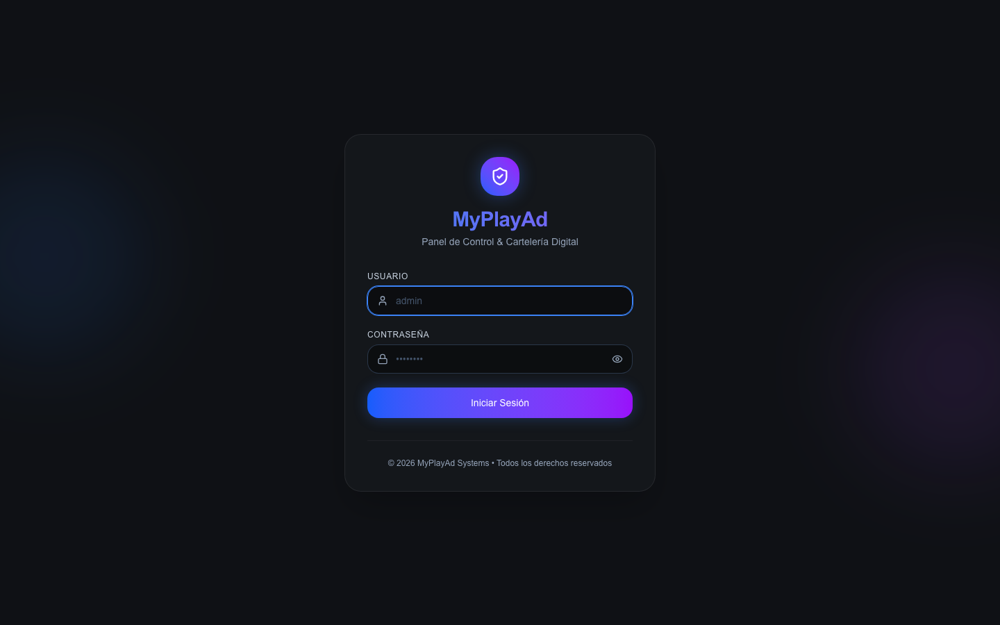
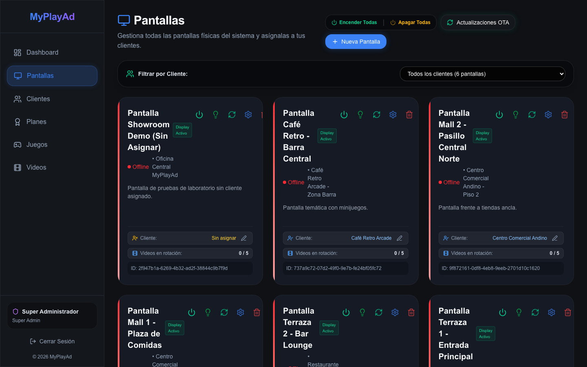
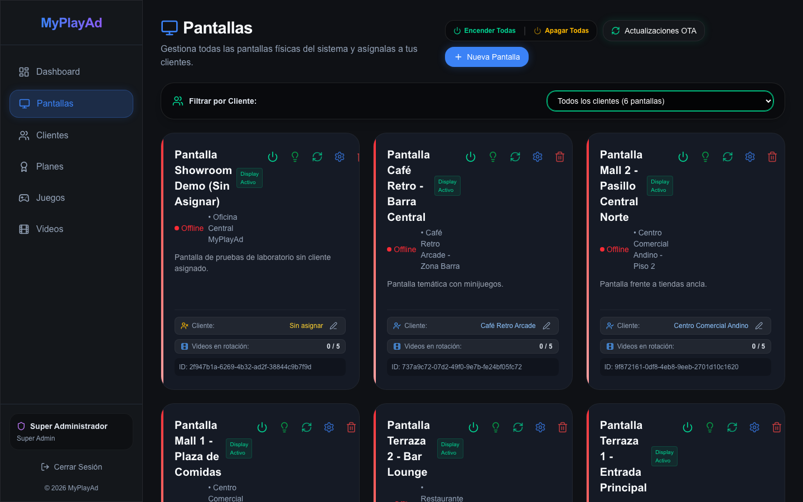
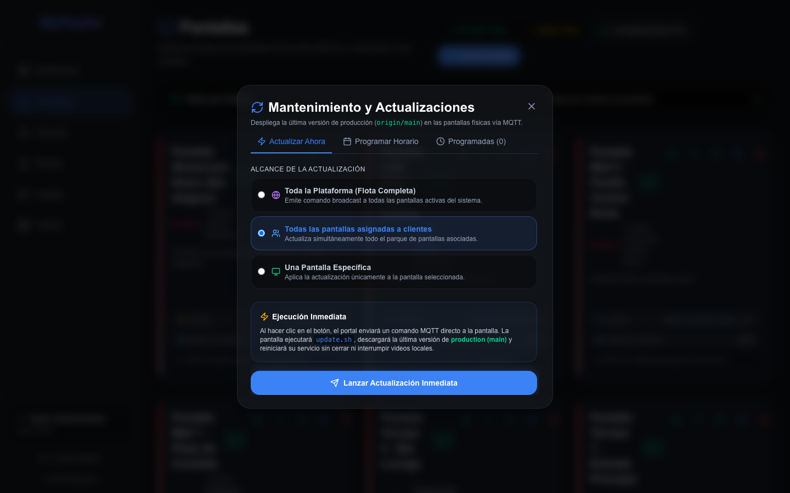
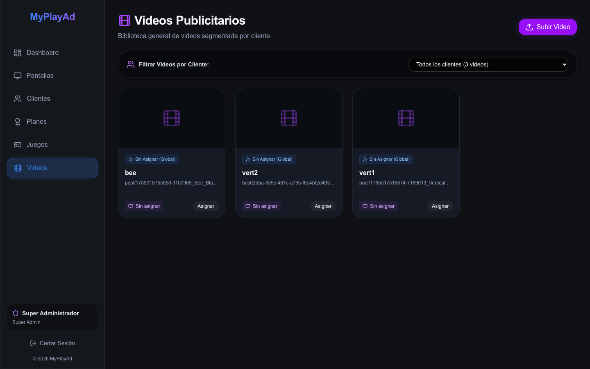
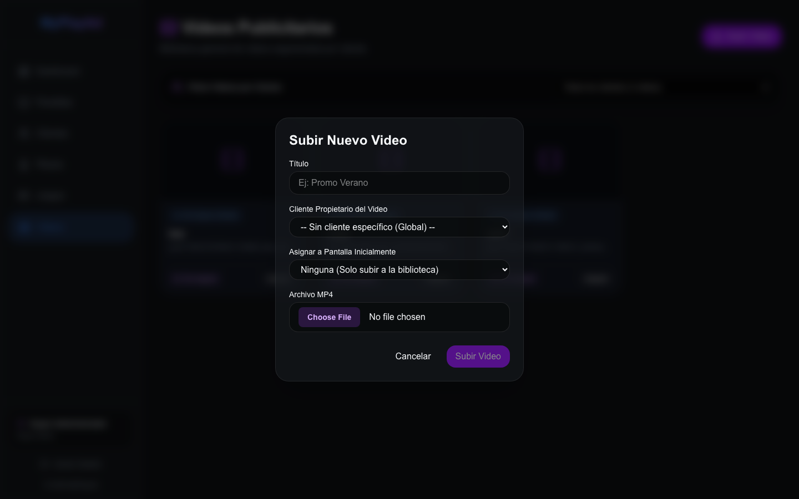
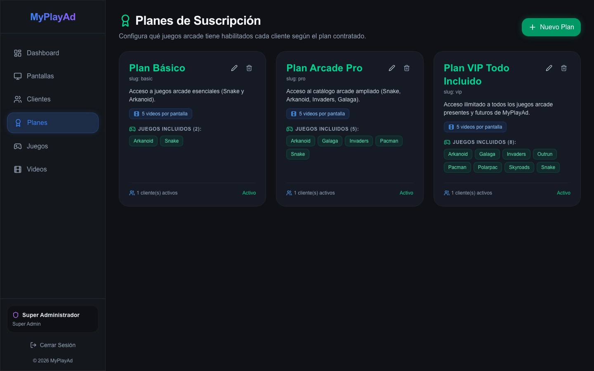
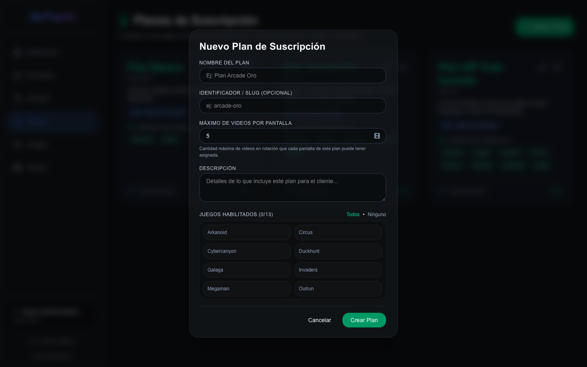
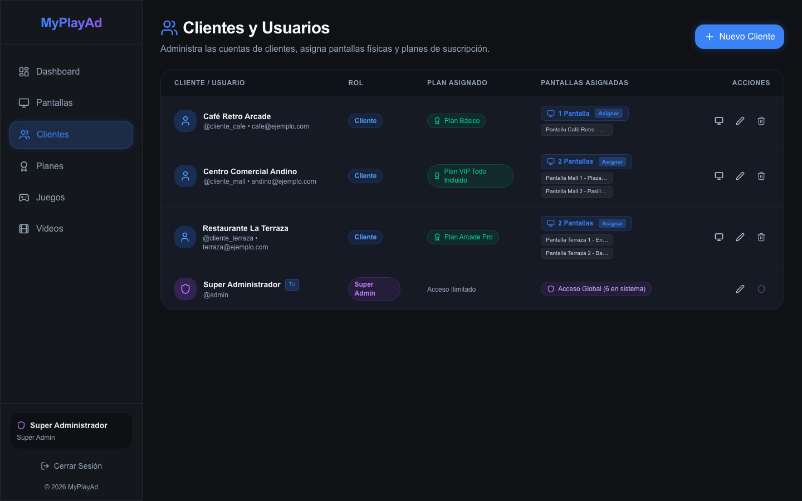
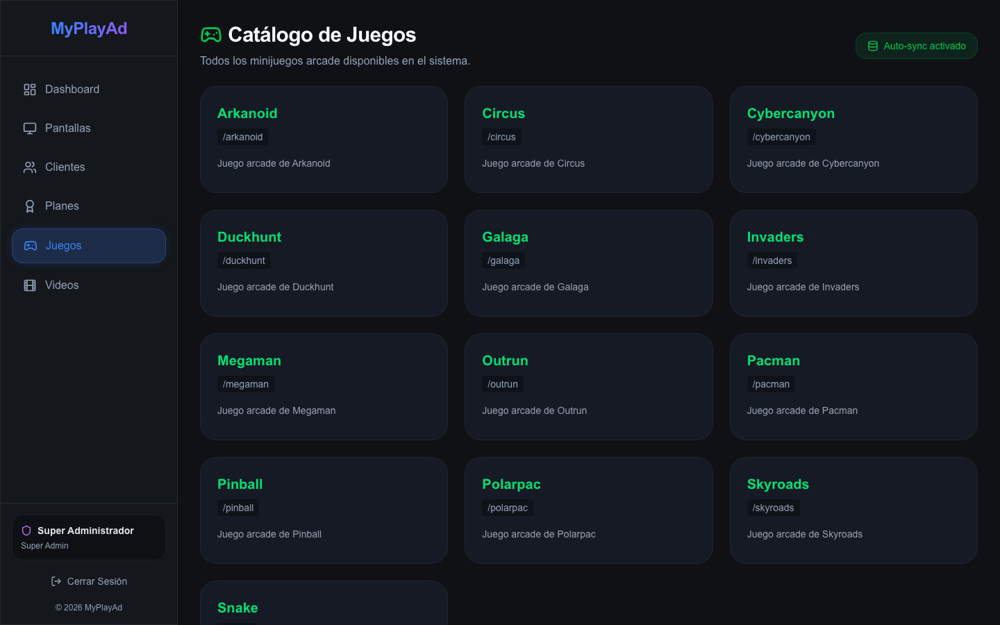

# Manual de Usuario y Administración del Portal Web — MyPlayAd

---

## 1. Introducción al Portal Administrativo

El **Portal Web de MyPlayAd** es el centro de control unificado desde donde administradores (`SUPER_ADMIN`) y clientes anunciantes (`CLIENT`) gestionan toda su red de pantallas digitales, asignación de spots de video publicitario, planes de suscripción, control de energía masivo y catálogo de minijuegos arcade.

* **URL de Staging (Entorno de Pruebas):** `https://dev-portal.myplayad.com`
* **URL de Producción:** `https://portal.myplayad.com`

---

## 2. Acceso y Autenticación

El acceso al portal está protegido mediante sesiones cifradas con tokens HMAC-SHA256 (`myplayad_session`).

### Pasos para Iniciar Sesión:
1. Ingresa a la URL del portal en cualquier navegador moderno.
2. Escribe tu **Nombre de usuario** y **Contraseña**.
3. Haz clic en **Ingresar al Panel**.
4. El sistema validará tus credenciales y te redirigirá automáticamente a la vista correspondiente según tu rol:
   * **Super Admin:** Acceso completo a pantallas globales, clientes, planes, biblioteca de videos y métricas de red.
   * **Cliente Anunciante:** Acceso enfocado a sus pantallas asignadas, carga de sus videos publicitarios y consulta del estado de rotación de su plan contratado.

---

## 3. Módulo de Pantallas (`/screens`)

El módulo de pantallas es el corazón operativo del sistema, permitiendo monitorear y controlar en tiempo real el parque de dispositivos físicos desplegados en puntos de venta.

### Funcionalidades Principales:
* **Métricas Globales:** Visualiza de un vistazo el total de pantallas registradas, pantallas encendidas, pantallas apagadas y tasa de disponibilidad.
* **Control Remoto Masivo HDMI-CEC:**
  * **Encender Todas:** Envía una orden MQTT `POWER_ON` a todas las pantallas activas, encendiendo físicamente los televisores comerciales conectados vía cable HDMI.
  * **Apagar Todas:** Envía una orden MQTT `POWER_OFF` para apagar masivamente los monitores al cierre comercial, ahorrando energía sin desconectar el sistema operativo.
* **Estado de Conexión en Tiempo Real:** Cada tarjeta de pantalla indica si el reproductor está online u offline, su dirección IP local, resolución actual y última hora de sincronización.
* **Indicador de Cuota de Videos en Rotación:** Muestra el cumplimiento de la cuota publicitaria (ej. `2 / 5 videos en rotación`), alertando si una pantalla no tiene videos asignados o si ya alcanzó su límite máximo permitido por su plan.
* **Vinculación de Consola Hardware (Raspberry Pi):** Badge interactivo con el usuario/ID de la Raspberry Pi física (ej. `consola1`, `consola2`). El Super Admin puede hacer clic en el botón de edición para vincular o actualizar la consola física asignada.
* **Copiado Rápido de SCREEN_ID:** Botón de un solo clic junto al ID de la pantalla que copia el UUID directamente al portapapeles con confirmación visual, facilitando pegarlo en `/boot/firmware/config.txt` al configurar una nueva consola.

---

## 4. Filtrado Avanzado de Pantallas por Cliente

Para redes con múltiples clientes o franquicias, el Super Administrador puede segmentar la vista para supervisar clientes específicos.

* **Todos los clientes:** Muestra el parque completo de pantallas del sistema.
* **Cliente Específico:** Filtra inmediatamente las pantallas asociadas a una cuenta comercial determinada.
* **Sin Asignar:** Identifica pantallas nuevas o en inventario que aún no han sido vinculadas a ningún cliente comercial.

---

## 5. Actualizaciones OTA y Mantenimiento Remoto

Desde el botón **Actualizaciones OTA** en la sección de pantallas, el administrador puede desplegar actualizaciones de software sin tener que trasladarse físicamente a los locales.

### Opciones de Mantenimiento:
* **Actualizar Software (Git Pull):** Descarga la última versión estable del reproductor desde GitHub y reinicia el servicio automáticamente.
* **Forzar Sincronización de Videos:** Obliga a las pantallas seleccionadas a revisar de inmediato si hay nuevos videos pendientes en el servidor central.
* **Reinicio de Sistema (Reboot):** Reinicia el hardware de la Raspberry Pi de forma segura.

---

## 6. Módulo de Videos Publicitarios (`/videos`)

En este módulo se gestiona el inventario de piezas publicitarias que se exhibirán en la zona de video del Kiosco Dual.

### Características de la Biblioteca:
* **Filtro por Cliente Anunciante:** Permite auditar el contenido por empresa o anunciante.
* **Previsualización de Videos:** Reproductor integrado para verificar que el spot cuente con la relación de aspecto adecuada (vertical 9:16 o 1080x1920) y buena calidad visual.
* **Badges de Asignación:** Indica en cuántas pantallas está rotando actualmente cada spot publicitario.

---

## 7. Carga y Asignación de Videos con Validación de Cuotas

Al hacer clic en **Subir Video**, se despliega el modal inteligente de carga:

### Proceso de Carga:
1. **Archivo de Video:** Arrastra o selecciona un archivo en formato `.mp4` o `.webm`.
2. **Cliente Propietario (Super Admin):** Selecciona el cliente al que pertenecerá el video publicitario.
3. **Asignación de Pantallas:** Selecciona a qué pantalla o pantallas se asignará el nuevo spot.
4. **Control de Cuotas en Tiempo Real:** El sistema valida contra el plan contratado por el cliente cuántos videos tiene permitidos por pantalla. Si una pantalla ya tiene su cupo lleno (ej. `5 / 5 videos usados`), el sistema bloquea la asignación para evitar sobrepasar los límites comerciales acordados.

---

## 8. Módulo de Planes y Cuotas (`/plans`)

El módulo de planes define las condiciones comerciales y técnicas del servicio publicitario.

### Elementos de cada Plan:
* **Nombre y Slug:** Identificador comercial (ej. *Plan Básico*, *Plan Pro*, *Plan Enterprise*).
* **Badge de Videos por Pantalla (`maxVideosPerScreen`):** Límite estricto de videos que cada pantalla asignada a este plan puede reproducir simultáneamente en su bucle (ej. `3 videos por pantalla` o `10 videos por pantalla`).
* **Precio Mensual:** Tarifa de suscripción periódica.
* **Juegos Incluidos:** Catálogo de minijuegos retro habilitados para los clientes suscritos a este plan.

---

## 9. Creación y Edición de Planes

Al pulsar en **Nuevo Plan** o en el botón de edición de un plan existente:

### Campos a Configurar:
1. **Nombre del Plan:** Nombre descriptivo visible para los clientes.
2. **Máximo de Videos por Pantalla:** Parámetro numérico clave que regula la cuota de rotación en el reproductor.
3. **Precio ($):** Valor en moneda local o USD.
4. **Minijuegos Permitidos:** Selección múltiple de los juegos arcade que se desbloquearán en las pantallas vinculadas a este plan.

---

## 10. Gestión de Usuarios y Clientes (`/users`)

En esta sección se gestiona el directorio de usuarios de la plataforma y sus privilegios de acceso.

### Tipos de Cuentas:
* **Super Admin:** Control total sobre todos los módulos, gestión de planes y acceso a todas las pantallas y videos.
* **Cliente:** Acceso restringido únicamente a sus propias pantallas y a la subida de sus propios anuncios, limitado por la cuota de su plan asignado.

Desde esta tabla, el administrador puede:
* Crear nuevos clientes con su respectivo plan de suscripción.
* Asignar pantallas físicas a clientes específicos.
* Restablecer contraseñas o modificar datos de contacto.

---

## 11. Catálogo de Minijuegos Arcade (`/games`)

El catálogo de juegos interactivos muestra la biblioteca de experiencias lúdicas disponibles en la plataforma MyPlayAd.

* **Juegos Clásicos y Nuevos:** Arkanoid, Snake Retro, Space Invaders, Cyber Canyon, etc.
* **Compatibilidad Móvil:** Cada juego cuenta con sus controladores web optimizados (joystick analógico, pad direccional de 4 vías o botones de acción hápticos) y su respectiva integración WebRTC de latencia cero.

